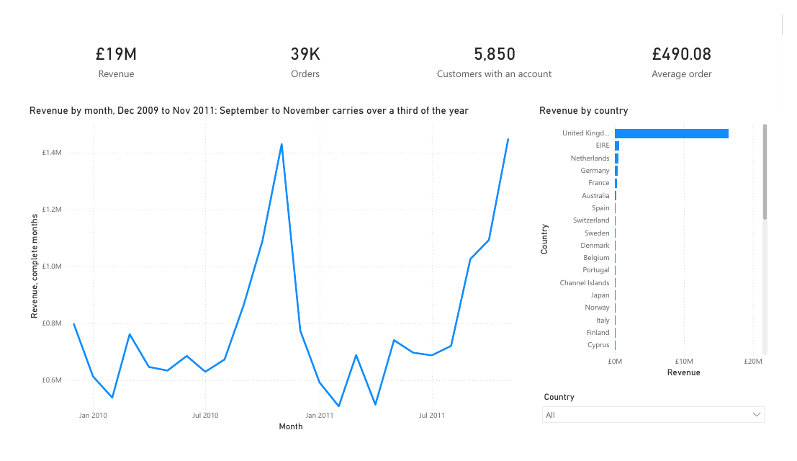
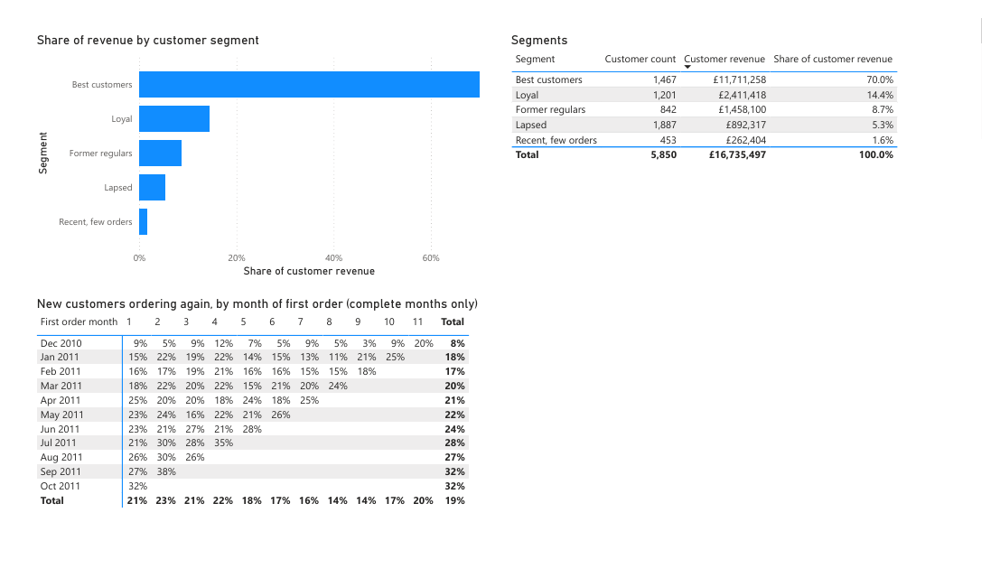
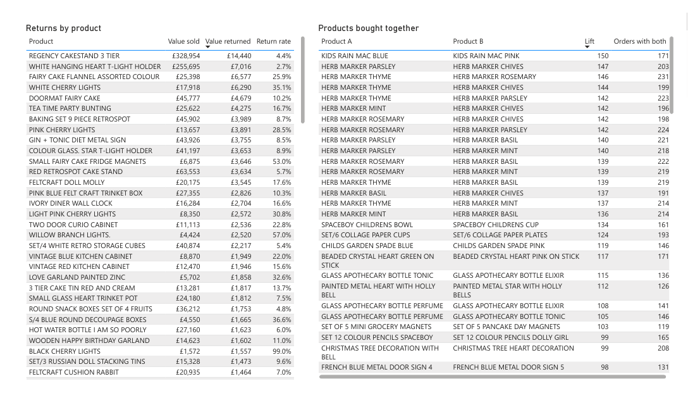

# Two years of a UK online retailer's sales

[](https://github.com/gumagatsby/retail-analysis-case-study/actions/workflows/ci.yml)

A data analysis of 1,067,371 real transactions from an online gift-ware retailer, December 2009 to December 2011, written for its owners. SQL in DuckDB, Python for the statistics, and a Power BI report.

**Start with the findings:** [docs/03-results.md](docs/03-results.md).

| | |
|---|---|
| [01-brief.md](docs/01-brief.md) | The six questions and what a good answer looks like |
| [02-decisions.md](docs/02-decisions.md) | Every cleaning rule and analysis choice, with the reason |
| [03-results.md](docs/03-results.md) | The answers, with a recommendation for each |
| [04-build-log.md](docs/04-build-log.md) | What went wrong or surprised me, and what I did |

## What it found

- September to November brings in 36 to 38% of the year's sales.
- A quarter of customers bring in 70% of the revenue; 842 former regulars who spent £1.46 million have gone quiet.
- Returns are 1.9% of sales overall, but four products come back between 23% and 35% of the time.
- 42% of new customers order again within three months (95% interval 39% to 45%).
- Overseas customers' typical order is £119 bigger than UK customers' (95% interval £89 to £149).
- Customers buy whole product ranges: all 50 of the most strongly linked product pairs are two items from the same range.

## The Power BI report

Three pages for the owners: the overview, customers, and products and returns. The saved report is [powerbi/RetailSales.pbix](powerbi/RetailSales.pbix), and [powerbi/RetailSales.pdf](powerbi/RetailSales.pdf) is the same report exported from Desktop.







The report is written as code. `powerbi/build_pbip.py` generates a Power BI Project (TMDL model, PBIR pages), and `powerbi/validate.py` checks it against Microsoft's schemas before Desktop sees it. CI regenerates the project and fails if it differs from the committed one. Desktop runs only on Windows, so `scripts/powerbi_vm.sh` creates a Windows machine in AWS, copies the project and data onto it, and deletes everything afterwards; the build log says how Desktop was driven on it.

## Cleaning, in one table

Every row is kept as a sale or set aside with a reason, and the categories add back up to the 1,067,371 rows in the workbook. A test checks each rule against the full dataset.

| | Rows |
|---|---|
| Sales | 1,015,071 |
| Copies of the same nine days in both sheets | 22,523 |
| Returns and cancellations | 17,974 |
| Postage, fees, adjustments, vouchers | 5,807 |
| Stock write-offs | 3,391 |
| Unpriced lines | 2,599 |
| Bad debt entries | 6 |

Inside the sales, 1,318 lines (£349,825) were orders reversed within 24 hours and 4 lines (£41,644) were mispriced. Both are excluded from the analysis.

## Running it

```bash
python3.13 -m venv .venv && .venv/bin/pip install -r requirements.txt
.venv/bin/python scripts/extract.py     # downloads the workbook from UCI and checks its checksum
.venv/bin/python scripts/build.py       # builds data/retail.duckdb from sql/
.venv/bin/pytest -q                     # every cleaning rule, on all 1,067,371 rows
.venv/bin/python analysis/run.py        # out/metrics.json, docs/figures/, data/powerbi/
.venv/bin/python powerbi/build_pbip.py  # the Power BI Project in powerbi/
.venv/bin/python powerbi/validate.py    # schema and field checks
```

The `.pbix` needs Power BI Desktop: `scripts/powerbi_vm.sh up` builds a Windows machine with it installed, `fetch` copies the saved files back and `down` deletes the machine.

## Data

Chen, D. (2012). Online Retail II [Dataset]. UCI Machine Learning Repository. https://doi.org/10.24432/C5CG6D. Licensed under CC BY 4.0. The workbook isn't stored here; `scripts/extract.py` downloads it.
