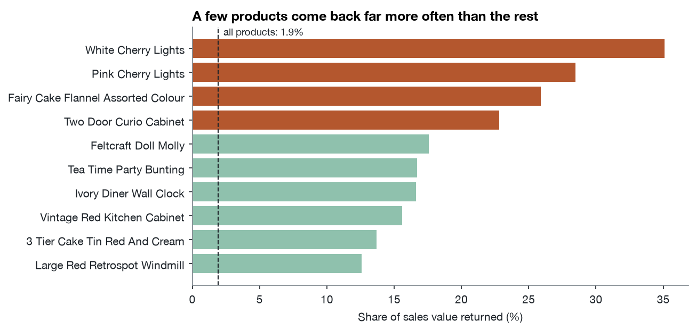
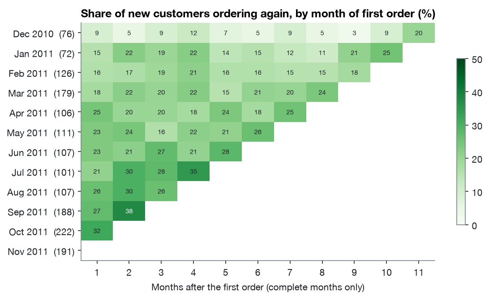
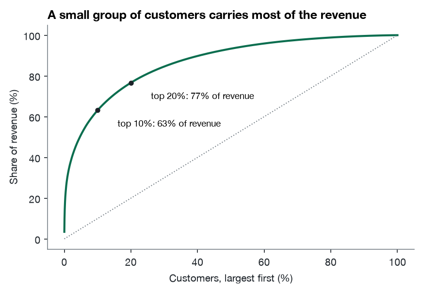
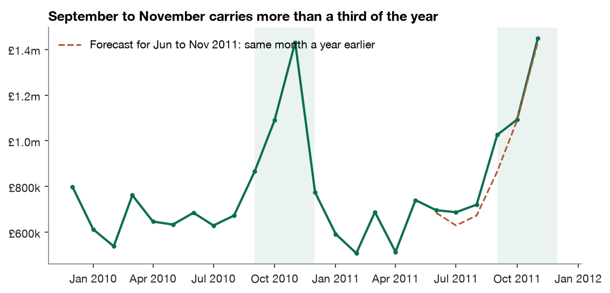
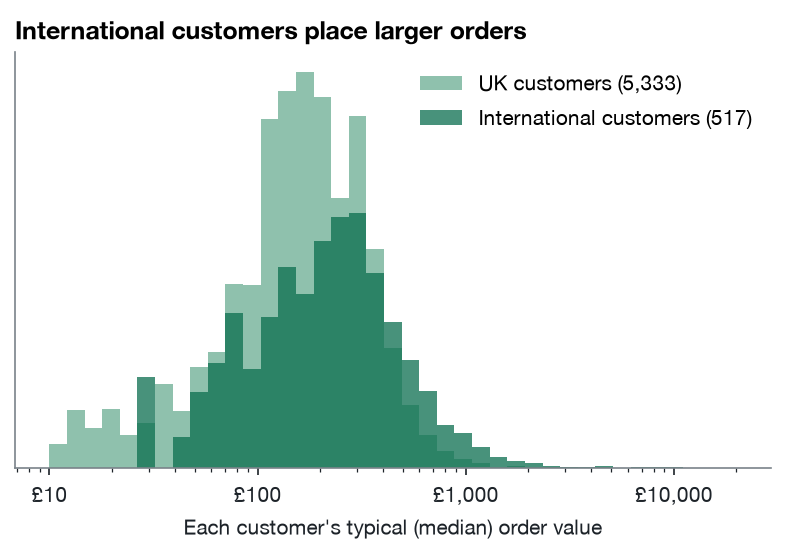

# What two years of sales say

Written for the owners. Every figure comes from `out/metrics.json`, which `analysis/run.py` produces from the cleaned data; how the data was cleaned is in [02-decisions.md](02-decisions.md).

## The short version

- The business sold £19.3 million of products over the two years, to 5,850 customers with an account, plus orders placed without one.
- The year is made in the autumn. September to November brought in 36% of the first year's sales and 38% of the second's.
- A quarter of customers bring in 70% of the money. The top 1% alone bring in 31%.
- 842 former regulars have gone quiet. They spent £1.46 million over the two years and haven't ordered in a year. They're the cheapest growth available.
- **Returns are low overall, 1.9% of sales, but a few products come back a quarter to a third of the time.** The cherry lights lead.
- Overseas customers order more each time. Their typical order is £119 bigger than a UK customer's.

## In numbers

| | Dec 2009 to Nov 2010 | Dec 2010 to Nov 2011 | Change |
|---|---|---|---|
| Sales | £9,369,909 | £9,493,090 | +1.3% |
| Orders | 19,688 | 18,901 | −4.0% |
| Average order | £475.92 | £502.25 | +5.5% |
| Share of the year from Sep to Nov | 36.1% | 37.6% | |

Sales held steady while orders fell, because each order got bigger. December 2011 is left out of comparisons: the data stops on the 9th.

## Q1. Returns

Customers returned £369,868 of goods over the two years, 1.9% of what was sold, across 7,096 return invoices from 2,359 customers.

Among products that sold at least £10,000, four came back far more often than the rest:

| Product | Sold | Returned | Share returned |
|---|---|---|---|
| White cherry lights | £17,918 | £6,290 | 35.1% |
| Pink cherry lights | £13,657 | £3,891 | 28.5% |
| Fairy cake flannel, assorted colours | £25,398 | £6,577 | 25.9% |
| Two-door curio cabinet | £11,113 | £2,536 | 22.8% |

By value, the most-returned product is the three-tier Regency cake stand, £14,440, but that's only 4.4% of the £328,954 it sold.

**Recommendation.** Look at the cherry lights first. Two colours of the same product both coming back over a quarter of the time points to the product itself: a fault, a misleading photo or description, or damage in transit. The data can't say which; the returns notes or the supplier can. The same check is worth doing for the flannel and the curio cabinet.

## Q2. New customers

The data starts in December 2009, so "first order in the data" isn't the same as "first order ever". Only customers first seen from December 2010, with a year of history behind them, can be called new with confidence.

From January to November 2011 the business won a median of 111 new customers a month, rising to between 188 and 222 a month from September to November.

Of the 985 new customers who placed a first order between December 2010 and August 2011, 411 ordered again within three months: **42%** (95% interval 39% to 45%). The chart shows the share of each month's new customers ordering in each later month.

The weakest group is December's: customers who first ordered in December 2010 came back least, 18% within three months. They're Christmas buyers, and January to March is the quietest time of year.

**Recommendation.** Follow up within the first month after a first order: more than half of new customers don't order again within three months. For December's first-time buyers, time it for the spring rather than January.

## Q3. Who carries the business

The top 10% of customers bring in 63% of the revenue, and the top 20% bring in 77%. The typical customer placed 3 orders and spent £856 over the two years. 28% ordered only once.

| Segment | Customers | Share of customers | Share of revenue | Typical days since last order |
|---|---|---|---|---|
| Best customers: recent and frequent | 1,467 | 25% | 70.0% | 16 |
| Loyal | 1,201 | 21% | 14.4% | 72 |
| Former regulars: frequent, but not for a year | 842 | 14% | 8.7% | 374 |
| Lapsed | 1,887 | 32% | 5.3% | 396 |
| Recent, few orders | 453 | 8% | 1.6% | 25 |

**Recommendation.** Two actions. Protect the best customers: they're a quarter of the base and 70% of the money, so an account manager or priority service for the largest of them is worth costing. Then win back the 842 former regulars, who spent £1.46 million and stopped about a year ago. A personal call or a reorder offer to the largest of them costs little against what they used to spend. The data can't say why they stopped; asking them is part of the exercise.

## Q4. The season, and next year's forecast

The best month was November 2011 at £1,447,946. The quietest was February 2011 at £508,678, about a third of that.

**Forecasting.** The simplest method, "the same month last year", was tested on June to November 2011, using only data from before June. It was out by 5.6% in an average month and 5.2% low over the six months. Adjusting it for the recent trend made it worse (9.7% in an average month), because the first half of 2011 ran below 2010 and the autumn then ran above it. With two years of data there is only one full season to learn from, so the honest forecast is "last year's month, with a margin of about 5 to 10%", and a better one needs another year of history.

**Recommendation.** Plan stock and staff from last year's month, and expect it to be up to 10% out either way. The autumn grew faster than the rest of 2011 (it was 37.6% of the year, up from 36.1%), so if anything, plan the autumn on the generous side.

## Q5. What sells together

Customers buy whole ranges. Every one of the 50 most strongly linked pairs is two items from the same range: the six herb markers, children's rain macs and garden tools in blue and pink, the Spaceboy children's bowl and cup, apothecary bottles, paper cups with matching plates. 93% of orders with the thyme herb marker also had the rosemary one, and 83% of orders with the blue rain mac also had the pink.

Further down the list the links stay within themes: the Treasure Island and Gymkhana book boxes (44% of Treasure Island orders had both), novelty door hangers, and dog bowls with cat bowls.

**Recommendation.** Sell the ranges as sets. Customers are already building them line by line: a "set of six herb markers" product would save them the effort and could carry a small set price. On the website, show the rest of the range on each product page.

## Q6. Selling abroad

The UK is 85.3% of sales. The other 42 countries brought in £2.83 million. The largest are Ireland (£615,518, from only 3 customers), the Netherlands (£549,775, 22 customers), Germany (£383,728, 107 customers) and France (£310,052, 93 customers).

A typical overseas customer's order is worth £382, against £263 for a UK customer: £119 more (95% interval £89 to £149). The difference is far too large to be chance (Mann-Whitney test, p < 0.001). Picking one overseas and one UK customer at random, the overseas one has the larger typical order 67% of the time. This compares customers, not orders, so a few very active customers can't drive the result.

**Recommendation.** Overseas customers are worth having, but Ireland and the Netherlands depend on a handful of accounts, so losing one would show. Germany and France have the broadest base of customers abroad, and they're where recruiting more customers is most likely to work. The case for spending on it depends on shipping costs and margins, which this data doesn't include.

## How sure each answer is

| Answer | Confidence | Why |
|---|---|---|
| Season, concentration, returns | High | Direct totals over two years of complete data |
| Overseas order values | High | Large difference, tested at customer level |
| New-customer returns | Medium | 985 customers; the interval is shown |
| Forecast | Low to medium | One season to learn from; scored on six months only |
| Why customers return goods or lapse | Not answered | The data has no reasons; the recommendations say how to find out |
